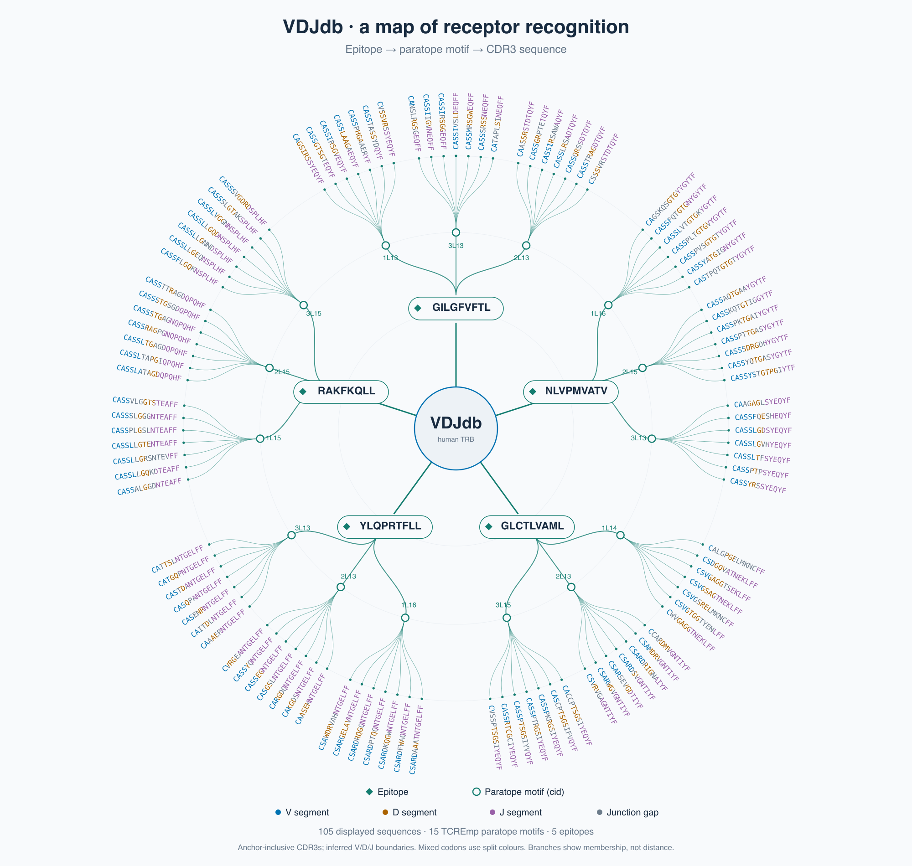

# VDJDB: A curated database of T-cell receptor sequences of known antigen specificity

[](https://docs.isalgo.dev/vdjdb-db/)
[](https://zenodo.org/records/22104776)
[](https://github.com/antigenomics/vdjdb-db/actions/workflows/build.yml)



VDJdb aggregates published information on T-cell receptor antigen specificity - the ability to
recognize certain epitopes in certain MHC contexts - and curates it into a single repository.

Each observation links a receptor to a peptide-MHC complex and its experimental evidence.
See [terminology](https://docs.isalgo.dev/vdjdb-db/standards/terminology.html) for the distinction
between the epitope, MHC restriction and source organism.

Routine updates keep the database current, and a validation scheme standardizes how specificity is
reported:

* Experimental evidence determines the legacy 0-3 confidence score. Separate record probabilities
  report assay validation (v3.2a) and detection in another study (v3.2b).
* Each record is also checked automatically against a database of V/J segment germline sequences,
  which standardizes reporting of the V-J junctions and CDR3 sequences that define a T-cell clone.

This repository holds the submissions to the database and the build that validates, assembles and
publishes it. `chunks/` is the data, one file per publication; everything else is machinery.

## Documentation

Start at [VDJdb documentation](https://docs.isalgo.dev/vdjdb-db/):

- **Tutorial:** [explore your first records](docs/getting-started.md).
- **How-to guides:** [submit records](docs/submission.md),
  [process a 10x dextramer assay](docs/tenx-dextramer.md) with the standalone
  [dCODE caller](processing/dcode_chain_graph.py), [build a release](docs/builds.md),
  [check experimental provenance](docs/submission.md#check-experimental-provenance-through-repertoire-overlap)
  and [validation evidence](docs/submission.md#classify-validation-evidence),
  or [verify build integrity](docs/build-integrity.md).
- **Reference:** [chunk format](docs/standards/chunk-format.md),
  [columns](docs/standards/columns.md), [legacy scoring](docs/standards/confidence-score.md),
  [record confidence v3.2a/v3.2b](docs/standards/record-scoring-v3.md) and
  [output files](docs/outputs.md).
- **Explanation:** [sequence repair](docs/standards/cdr3-fixing.md),
  [motif statistics and denoising](docs/denoising.md),
  [embeddings, clustering and evaluation formulas](docs/clustering.md), and [the dashboard](docs/dashboard.md).

Column tables, vocabularies and score rules are generated from the package declarations when the
site builds. The [summary dashboard](https://docs.isalgo.dev/vdjdb-db/dashboard.html) follows the
latest successful build on `master`; released downloads are dated snapshots.

For corpus checks, distinguish repeated source rows from assembled observations. The build removes
duplicate curation within a publication and preserves distinct experiments. See
[metadata and reference checks](docs/build-integrity.md#check-metadata-and-references).

## Using the data

| Task | Start here |
|---|---|
| Annotate a receptor, paired clone or repertoire | [Query with vdjmatch](docs/using-vdjdb.md#annotate-a-receptor-or-repertoire-with-vdjmatch) |
| Inspect the evidence for a reported specificity | [Methods, publications and record confidence](docs/using-vdjdb.md#check-reliability-of-a-specificity-record) |
| Retrieve motif members and position-specific frequencies | [Released TCRNET and TCREmp motifs](docs/using-vdjdb.md#retrieve-released-sequence-motifs) |
| Fetch matching native or predicted coordinates | [Record-to-structure lookup and download](docs/using-vdjdb.md#fetch-coordinates-for-a-record) |

Download the latest release zip from
[the releases page](https://github.com/antigenomics/vdjdb-db/releases). A web GUI is at
[vdjdb.com](https://vdjdb.com), served by [VDJdb-web](https://github.com/antigenomics/vdjdb-web).

[vdjmatch](https://github.com/antigenomics/vdjmatch) can resolve a release for you when annotating
repertoires. It selects release bundles by their manifest role, or reads an explicit local
build directory with `--vdjdb /path/to/build/tables`. The [usage guide](docs/using-vdjdb.md)
provides commands, table queries and interpretation guidance.

The [structure dataset](https://huggingface.co/datasets/isalgo/vdjdb_structure_models) supplies
predicted and native coordinates, current record-ID links, and explicit dispositions for withdrawn
assignments and modified ligands. See [build contents and structure cross-links](docs/outputs.md)
for the compact Parquet/gzip tables, compatibility exports, match flags and archive-member joins.

## Building it

```bash
uv sync --extra motifs --extra confidence --extra summary --extra test
uv run vdjdb qc                               # chunk validation, fail-fast
uv run vdjdb build --out out/                 # the definitive tables, then every projection
uv run vdjdb make legacy --tables out/tables  # the legacy files
uv run vdjdb convert airr --tables out/tables # AIRR tables
uv run vdjdb motifs --tables out/tables       # TCRNET + TCREMP
uv run vdjdb score-records --tables out/tables # frozen record confidence v3.2a/v3.2b
uv run vdjdb summary --legacy out/legacy      # the dashboard, offline
uv run vdjdb identity check --tables out/tables # the identifier invariants
uv run vdjdb corpus build --tables out/tables # the reference corpus: tf-idf over 12 token families
uv run vdjdb diff <reference.zip> out/legacy  # compare against a released zip
VDJDB_REFERENCE_ZIP=reference.zip uv run pytest -q
```

Use the 2026-06-03 release as `reference.zip` for the release comparison and tests. The static
summary also requires R and pandoc; see [build requirements](docs/builds.md).
Optional supplemental structure inputs and explicit legacy scoring modes are described
in [record confidence v3.2a/v3.2b](docs/standards/record-scoring-v3.md).

## 10x dextramer assays

The chain co-occurrence caller in `processing/dcode_chain_graph.py` turns a donor's contig
annotations and dextramer UMI matrix into specificity calls. `process_donor(dcode, donor)` is
that call for one donor. The command line takes `--dcode`, `--donors` and `--out` and writes
`chains.tsv`, `edges.tsv`, `clones.tsv`, `calls.tsv` and `checks.tsv`.

`chunks/ISSUE_289.tsv` (28,040 rows, the four-donor Immudex dCODE assay) is the committed output
of that caller. Deposited ITRAP matrices go through `processing/itrap_reprocess.py` into the same
model: `itrap1_tables` then `run_frames` for PMID:37133356, and `viral_tables` then `run_frames`
for the viral assay. The committed files `chunks/PMID_37133356.tsv` (1,440 rows) and
`chunks/DOI_10.64898_2025.12.19.695506.tsv` (2,468 rows) are the published assignment tables.
The procedure is [Process a 10x dextramer assay](docs/tenx-dextramer.md).

## Contributing

Researcher skills are kept in `skills/researcher/`, separately from the submission and
maintenance skills in `skills/curator/`. Start with the [VDJdb consumer skill](skills/researcher/vdjdb-use/SKILL.md).
It routes queries, evidence review, motif retrieval and structure downloads to the same
documented workflows. [Curation skills](skills/curator/AUTHORITIES.md) cover source review and submission.

New records are submitted as chunks - see [the submission guide](docs/submission.md). A chunk pull
request is checked in under three minutes by `chunk-check`, against the specification documented
above.

## Citing

Please cite the most recent paper:

> Daniil V. Luppov, Anna E. Koneva, Dmitry V. Bagaev, Anastasiia V. Alexandrova, Elizaveta K.
> Vlasova, Dmitry M. Chudakov, Chihiro Motozono, Andrew K. Sewell & Mikhail Shugay. VDJdb in 2026:
> boosting T-cell receptor recognition evidence using paratope embeddings and AI-based structure
> prediction. *Nucleic Acids Research*, 2026.
> [doi:10.1093/nar/gkag904](https://doi.org/10.1093/nar/gkag904)

A release of the database itself is archived at
[doi:10.5281/zenodo.22104776](https://doi.org/10.5281/zenodo.22104776).
