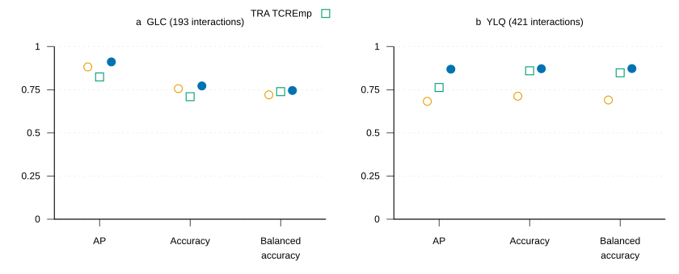

# Record confidence score v3

Record confidence v3 combines publication, donor, motif and predicted-structure evidence
in one frozen Bayesian network. It returns a paired forecast and two chain-only views
of validation of the same receptor:pMHC interaction. The existing `vdjdb.score` remains
the legacy 0-3 score; v3 is a separate table linked by `record_id`.


**Figure 1. Record scoring pipeline.** Current records and completed chain-level motif
and record-level structural evidence are integrated at gene-level receptor:pMHC identity.
One fitted network supplies all three forecasts. Missing evidence is marginalized;
missing chain and structural evidence also defines a sensitivity envelope. The result
is joined back to every observational record ID, including independent reports of the
same interaction. Model parameters are inputs; no fitting occurs during a build.

## Run the pipeline

```bash
uv sync --extra motifs --extra confidence --extra test
uv run vdjdb build --out out/ --structure-metadata input-metadata.tsv.gz
uv run vdjdb motifs --tables out/tables --out out/motifs
uv run vdjdb score-records --tables out/tables
```

The metadata argument supplies the reviewed structural input described in
[build instructions](../builds.md). A build without it can still be scored; unavailable
ipTM is marginalized. Scoring requires the completed motif stage and refuses a table
with no motif evidence. CI runs scoring after motifs with the packaged model. `--model`
selects an explicitly supplied frozen JSON artifact; `--out` selects a separate output
directory. Default output is the input table directory.

`record_scores.parquet` and `record_scores.tsv.gz` contain exactly one row per current
`record_id`, sorted by ID. TSV has a deterministic gzip header; unknown values are empty
cells. Parquet retains typed nulls. No column is appended to a legacy positional file.
The primary bundle includes both score files when that stage has run; the hosted build
requires their production and verifies their cardinality. The model SHA256 is recorded
on every row. No stored feature or prediction rows are reused between builds.

| Columns | Type / interpretation |
|---|---|
| `record_id` | Current observation identifier; unique primary key |
| `a_studies`, `b_studies` | Distinct publication counts for the TRA/TRB chain, peptide and V gene |
| `donors` | Distinct nonempty publication/donor contexts for the exact integrated receptor:pMHC |
| `a_tcrnet`, `b_tcrnet`, `a_tcremp`, `b_tcremp` | Hard membership: 1 member, 0 explicitly scored nonmember, missing if unannotated |
| `iptm` | Mean ipTM on [0,1] over distinct accepted predicted models of that interaction |
| `legacy_score` | Maximum built legacy score over the integrated interaction |
| `paired`, `record_score` | Identical probabilities from all available evidence, on [0,1] |
| `TRA`, `TRB` | Probabilities conditional only on that chain's publication and motif evidence |
| `paired_lower`, `paired_upper` | Sensitivity envelope on [0,1], including the nominal paired forecast |
| `direct_pair_evidence` | An exact-pair reference annotation, donor support or accepted predicted structure |
| `pair_supported` | Direct pair evidence or positive support for both chains; descriptive |
| `positive` | True if lower limit ≥0.5, false if upper limit <0.5, missing otherwise |
| `score_version`, `model_sha256`, `soft_membership` | Version `3`, exact frozen model identity and the inference mode |

Publication counts use the established chain/peptide/V-gene grouping, not a count of
independent experiments on the paired construct. Donor labels are scoped to their
publication. Repeated annotations of one structural model contribute once to mean ipTM.
Native experimental structures do not contribute predicted ipTM and were excluded from
model fitting and evaluation. The source feature definitions match the accepted model.

## Model and parameter defaults

The deployment fit uses 614 labelled interactions, nine predictors and sixteen directed
edges. Validation is a parent of every predictor. The nonstructural predictors also
form a conditional dependence tree; ipTM has only validation as its parent and no
children. Removing unavailable ipTM therefore preserves the fitted chain-evidence
network. No epitope name, MHC allele, sequence embedding or outcome is a predictor.
The endpoint is the measured assay validation criterion `padj < 1e-5`.

| Setting | Accepted deployment value | Other implemented or assessed settings |
|---|---|---|
| Model | Packaged `vdjdb.score/record_v3.json`; one all-labelled fit | `--model` explicitly selects another artifact; no automatic model search |
| Dependence graph | `tan_independent_iptm` | Generic `fit()` supports `tan`, `tan_leaf`, `naive`; these do not replace the packaged fit |
| Dirichlet equivalent sample size | 10 for every node | `fit()` accepts a positive scalar or complete node map; stronger smoothing was not promoted |
| Count encoding | 0, 1, 2, 3+ | Fixed encoding; no build-time bin fitting |
| ipTM encoding | Low <0.737694501876831; mid below 0.8368270099163055; high otherwise | Boundaries saved with this fit; generic `categorical()` defaults to 0.5/0.8 unless supplied |
| Motif membership | Hard, producer-owned membership | `soft_membership=False` throughout the inference API; fractional memberships require explicit `True` |
| Missing evidence | Exact marginalization, including legal states absent from training | No zero imputation or complete-case exclusion |
| Decision threshold | 0.5, fixed | No per-epitope threshold tuning during deployment |
| Prior / temperature | Saved fitted prior; no post-fit temperature correction | Prior 0.5/0.7/0.9 and temperature comparisons were diagnostics, not deployment options |
| Random seed | `vdjdb.config.SEED`, stored as 20260925 | Inference does not sample |

`fit()` is a generic training API whose default graph is `tan`; calling it is not the
production pipeline. Production reads the accepted parameters without fitting. Any
new fitted settings require their own grouped validation before selection.

Soft membership mixes the nonmember/member posteriors with supplied weights `1-q` and
`q`. Several uncertain memberships use an independent mixing distribution, while the
BN retains its fitted feature dependencies. Hard endpoints are unchanged. Direct
Hamming-1 membership-fraction substitution reduced paired AP from 0.911197 to 0.909023
for GLC and from 0.869028 to 0.867734 for YLQ, and lost two correct GLC TRB calls.
It remains off. `score-records --soft-membership` explicitly selects this exploratory
variant. It performs one substitutions-only batched native search, includes exact
neighbours, retains each producer's species/chain/peptide and V/J scope, and adds
`*_members` / `*_neighbours` integer columns for each motif fraction. Publication
counts and record identity stay unchanged. Ordinary scoring runs no neighbourhood search.

## Missing evidence and decisions

TRA and TRB condition on the respective chain's three predictors. They predict the
paired assay endpoint, not a single-chain binding experiment. Do not multiply them
with each other or the paired probability: these forecasts share a model and evidence.

The sensitivity envelope completes missing chain variables and ipTM with states
observed during training, considering their joint combinations. Metadata stays
marginalized and the nominal forecast is included. Without direct pair evidence,
the envelope also includes both chain-only forecasts. Unreported or unsupported
states do not create positive evidence. The envelope is not a credible interval.

Missing pair evidence never sets `record_score` to zero. Neither support flag gates
the forecast. `positive` is a separate conservative decision: an envelope crossing
0.5 yields unknown. Report the unknown count alongside definite calls. An absent
partner or an unrelated structural model cannot supply direct evidence for a new pair.

## Performance with continuous and binary scores

The accepted comparison uses five shared-junction grouped held-out folds, with all
193 GLC and 421 YLQ interactions retained for each predictor. AP is step-integrated
average precision, including tied scores. Accuracy uses the recorded classification
rules; ipTM decisions use the original training-fold cutoff, and motif decisions use
membership. V3 uses its fixed 0.5 threshold. No cutoff is reselected here.

Balanced accuracy is suitable for binary decisions and unequal class counts:

$$\mathrm{BA}=\tfrac12\left(\frac{TP}{TP+FN}+\frac{TN}{TN+FP}\right).$$

TP and FN count validated interactions; TN and FP count nonvalidated interactions.
Thus BA averages sensitivity and specificity. AP also accepts discrete scores; ties
are evaluated together. The [scikit-learn definition](https://scikit-learn.org/stable/modules/generated/sklearn.metrics.balanced_accuracy_score.html)
provides the metric contract. The exported comparison additionally reports Matthews
correlation coefficient, FP/(FP+TN) and FP/(TP+FP).

| Epitope | Interactions (validated / nonvalidated) | Predictor | AP | Correct calls / interactions | Balanced accuracy |
|---|---:|---|---:|---:|---:|
| GLC | 193 (134 / 59) | ipTM | 0.882286 | 146 / 193 | 0.720276 |
| GLC | 193 (134 / 59) | TRA TCREmp | 0.824280 | 137 / 193 | 0.738869 |
| GLC | 193 (134 / 59) | V3 paired | **0.911197** | **149 / 193** | **0.745699** |
| YLQ | 421 (172 / 249) | ipTM | 0.682605 | 300 / 421 | 0.690506 |
| YLQ | 421 (172 / 249) | TRA TCREmp | 0.762786 | 362 / 421 | 0.848265 |
| YLQ | 421 (172 / 249) | V3 paired | **0.869028** | **367 / 421** | **0.872688** |

TRA TCREmp is the strongest individual motif baseline on these three metrics in each
epitope. [The complete 28-row comparison](../_static/record-score-v3/metrics.tsv) includes
TRA/TRB/both/any TCRNET and TCREmp membership, publication counts and ipTM. V3 exceeds
every supplied individual baseline on AP, accuracy and balanced accuracy in both epitopes.



**Figure 2. Grouped held-out validation performance.** (a) GLC, 193 interactions;
(b) YLQ, 421 interactions. Orange circles show ipTM, green squares TRA TCREmp membership,
and blue filled circles v3. AP, accuracy and balanced accuracy share a 0-1 scale.
The points summarize the same cases in each epitope; there are no error bars or
additional significance tests. Full confusion counts are in the linked table.

`vdjdb score-metrics predictions.parquet --out metrics.tsv` checks exact case, fold and
outcome agreement before comparing predictors. Its input columns are `case`, `epitope`,
`predictor`, `fold`, `y`, `score`, `predicted`. It fails if the `v3` predictor regresses a
supplied baseline on AP, accuracy or balanced accuracy. This command evaluates saved
held-out forecasts without refitting. Assay-level identities and inputs remain private.
CI checks the reviewed aggregate comparisons, packaged model identity and fixed synthetic
forecast probes; it does not claim to rerun the private assay validation.

## False positives and negative-source calls

At the fixed nominal decision threshold, the assay confusion counts are:

| Epitope | TP | FP | FN | TN | False-positive fraction FP / (FP + TN) | False-discovery fraction FP / (TP + FP) |
|---|---:|---:|---:|---:|---:|---:|
| GLC | 109 | 19 | 25 | 40 | 19 / 59 (32.20%) | 19 / 128 (14.84%) |
| YLQ | 151 | 33 | 21 | 216 | 33 / 249 (13.25%) | 33 / 184 (17.93%) |
| Both | 260 | 52 | 46 | 256 | 52 / 308 (16.88%) | 52 / 312 (16.67%) |

The separate source-negative assessment uses all 37 files in `chunks_negative/`, with
repeated source observations retained and no fitting on these rows:

| Scope | Source observations | Nominal positive | Confident positive | Confident negative | Unknown |
|---|---:|---:|---:|---:|---:|
| All files | 6,062,284 | 2,155,249 (35.5518%) | 3,747 (0.0618%) | 16 | 6,058,521 |
| Human class I with specified context | 5,015,831 | 1,116,387 (22.2573%) | 3,740 (0.0746%) | 6 | 5,012,085 |

Percentages divide by the observation count in the same row. Confident calls use the
envelope, while nominal calls threshold `record_score`. The source-negative positive
fraction is not an estimate of the false-record prevalence in positive VDJdb records.
The model avoids confident acceptance for most of this collection by returning unknown:
definite-call coverage is only 3,763 / 6,062,284 (0.0621%). It does not establish those
unknown observations as negatives. The assumed 10-50% false-record prevalence explored
previously is a prior scenario, not a measured corpus error fraction.

## Python API and implementation

```python
from vdjdb.emit.vdjdb3 import read_table
from vdjdb.score.evidence import integrate
from vdjdb.score.pipeline import load_model
from vdjdb.score.bayes import score_records

records = read_table(tables, "records")
chains = read_table(tables, "chains")
evidence = read_table(tables, "evidence")
features = integrate(records, chains, evidence)
model, model_sha256 = load_model()
forecasts = score_records(model, features)
```

`integrate()` owns feature definitions, identity and aggregation. `interactions()`
creates canonical record-to-interaction keys. `bayes` owns fitting, exact inference,
chain views, optional soft inference and missing-evidence ranges. `pipeline.record_scores()`
scores distinct interactions once, then restores every record ID through a validated
many-to-one join. `pipeline.run()` reads completed tables and writes both compressed
formats. Existing Polars joins and batched inference suffice; there is no worker pool.

For explicit soft inference use `score_records(model, numeric_frame,
soft_membership=True)` or the same keyword on `predict`, `predict_marginals` and
`predict_evidence`. Fractions are rejected by default. Omitted evidence columns are
unobserved, and extra identity columns are ignored by numeric inference. Count and
ipTM validation reject invalid ranges and noninteger counts.

## Limits of the evidence

These two-epitope results are grouped development evidence after model refinement,
not an untouched external estimate of the complete selection procedure. They establish
assay validation discrimination, not affinity, function or clinical response. Native
experimental structures are excluded. CIN/NLV have scored examples without measured
validation endpoints, so accuracy there is unmeasured. Cross-epitope calibration is
not established. The chosen fit preserves accepted TRA/TRB/no-ipTM marginals; its YLQ
paired AP is 0.001975 below an earlier paired-only candidate whose marginal regressions
prevented selection. Confidence envelopes describe sensitivity to unavailable evidence
and do not guarantee frequentist coverage. Source-negative labels and withdrawn 10X
assignments are distinct; a discarded assignment is not an experimentally negative TCR.
