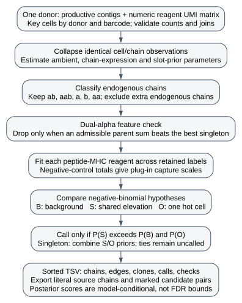

# Process a 10x dextramer assay

A publication or source dataset is one chunk; keep its donors separate during fitting. The caller is
`processing/dcode_chain_graph.py`. Call `process_donor(dcode, donor)` for one donor, or the
command below for the donors that belong to a chunk. Deposited ITRAP count tables use
`processing/itrap_reprocess.py`, which reshapes those tables and then calls the same model.
The negative-binomial mixture is not retuned there.

## Call the donor matrices

```bash
uv run python processing/dcode_chain_graph.py \
  --dcode /path/to/matrices \
  --donors 1 2 3 4 \
  --out /path/to/out
```

`--dcode` is the directory of per-donor matrices. `--donors` defaults to `1 2 3 4`. `--out` is
the directory that receives the five tables.

Each donor reads two files:

- `vdj_v1_hs_aggregated_donorN_all_contig_annotations.csv.gz`
- `vdj_v1_hs_aggregated_donorN_binarized_matrix.csv.gz`

`N` is the donor integer. The matrix file is numeric UMI counts. A column whose name ends in
`_binder` is a previous call and is not read. Surface-protein columns are not specificity evidence.

`process_donor` returns five frames: `chains`, `edges`, `clones`, `calls`, `checks`. The command
writes those frames as tab-separated tables named `chains.tsv`, `edges.tsv`, `clones.tsv`,
`calls.tsv` and `checks.tsv`. `calls.tsv` is the specificity table: one row per called label and
peptide, with the posterior of the specific hypothesis in `score`.

## What a call is

A node is one chain, named by locus, V, J and junction. An edge is two chains in one cell barcode
and stores both TCR contig UMI counts. A kept label is alpha-beta, alpha-alpha-beta, alpha only,
beta only, or two alphas. A second beta is not a label. An alpha-alpha-beta barcode is dropped
when its dextramer counts fit the sum of two parent clones. Contig UMI does not rescale the
dextramer UMI on a kept barcode.

Cells per label are the sample size. TCR contig UMI is the chain-graph weight. Dextramer UMI
counts captured reagent barcode molecules and is a proxy for binding signal. Specificity is a
per-peptide negative-binomial mixture, and the call is the maximum a posteriori hypothesis. A tie is uncalled. The formulas below specify the model implemented in
`processing/dcode_chain_graph.py`; the module docstring gives a shorter overview.

These matrices already use the AIRR junction, with both anchors included. A non-functional J
call and a non-canonical anchor are advisory findings. Leave the source sequence as reported.
Assembly keeps a submitted `TRAJ58` or `TRAJ25` when the junction's 3' end matches that ORF
germline and no functional TRAJ matches it as well.

## Corresponding chunks

| Chunk file | Rows | reference.id | Callable | Committed content |
|---|---:|---|---|---|
| `chunks/ISSUE_289.tsv` | 28040 | 10x application note | `process_donor` / the command above | chain-graph calls |
| `chunks/PMID_37133356.tsv` | 1440 | `PMID:37133356` | `itrap1_tables`, then `run_frames` | published ITRAP1 table |
| `chunks/DOI_10.64898_2025.12.19.695506.tsv` | 2468 | `doi:10.64898/2025.12.19.695506` | `viral_tables`, then `run_frames` | published ITRAP2 table |

The four-donor `reference.id` and `meta.study.id` are the application note
`https://www.10xgenomics.com/resources/application-notes/a-new-way-of-exploring-immunity-linking-highly-multiplexed-antigen-recognition-to-immune-repertoire-and-phenotype/#`.
The viral chunk's `meta.study.id` is `E-MTAB-13758`. The published table leaves `antigen.gene`
and `antigen.species` blank. Those cells are filled as provenance aliases: the epitope dictionary
where it has the peptide, otherwise the IEDB parent protein and source organism, using the gene
symbol VDJdb already records for that epitope when it is the same protein.

`itrap1_tables` reads a deposited GEM table. `viral_tables` reads the deposited contig lists,
the 10x antibody matrix and the barcode-to-peptide key. Both return a contig frame and a
barcode-by-peptide count frame. `run_frames` runs one donor at a time through the chain graph
and the specificity model, and returns the same five keys. `write_result` writes those keys
under the same five filenames.


## Algorithm and observational units



Editable diagram: [Graphviz source](_static/dcode-method.dot).

The input is a productive TRA/TRB contig table plus numeric dextramer and negative-control
UMI counts. A cell key is `(donor, barcode)`, not the barcode alone. A chain key is
`(locus, V, J, junction_aa)`. The Cell Ranger field named `cdr3` in this deposit contains
the anchor-inclusive junction; it is not IMGT CDR3. Chunk export preserves literal short junctions when they satisfy the chunk schema;
it does not delete a reported chain merely because it is shorter than eight residues.
Counts must be finite nonnegative integers,
including integer-valued floats. A missing measurement is not an observed zero. A measured
absence of a reagent is zero; a structurally absent reagent in a reshaped panel is also filled
with zero by its loader and must be distinguished in source review.

```text
for each donor independently:
    collapse repeated contigs by cell and chain; sum their TCR UMIs
    list co-occurring chains; estimate ambient and chain expression rates
    infer endogenous chains using expression likelihood and chain-slot prior
    retain supported receptor shapes; form labels from their exact chain keys
    compare dual-alpha feature profiles with admissible parent profiles
    for each peptide-MHC reagent:
        estimate background and elevated-count hypotheses across labels
        call a label when the shared-elevation posterior exceeds both alternatives
    export chain decisions, co-occurrence edges, retained labels, calls and diagnostics
```

Co-occurrence edges describe the input. The graph is not a sequence-similarity clustering
algorithm: it neither changes junctions nor merges nearby receptors. An exact chain-set label
can contain several cells in one donor. Different donors are fitted independently. Distinct
cells within a clone support a coherent signal; they are not independent donor replicates.

### Endogenous-chain likelihood

Let $x_i$ be a chain's TCR UMI count in cell $i$. Within each cell and locus, order chains by
count, breaking ties by the chain key. The first two TRA slots and first TRB slot are primary;
further chains are excess. `_ambient_rate` fits the excess counts to a two-Poisson mixture,
with the upper mean fixed to the pooled primary-slot mean $u$:

$$
f(x)=(1-\rho)\operatorname{Pois}(x;\lambda)+\rho\operatorname{Pois}(x;u).
$$

Here $\lambda$ is the shared lower, ambient mean and $\rho$ is the upper-component weight.
It uses up to 25 responsibility/weighted-mean updates, clipping $\rho$ to $[0.001,0.999]$.
The lower mean is floored at $10^{-8}$. If primary or excess counts are absent, the excess mean
is at least $u$, or the lower component has less than one effective observation, the function
returns that floor. Non-cell contigs are retained by `chain_table`, but are excluded from co-occurrence edges
and from fitting endogenous chains. The floor is a fallback, not a measured empty-droplet rate.

For each chain across cell barcodes, `_component_means` compares one count component with a
two-Poisson mixture. The one-component model is Poisson unless the unbiased sample variance
$v$ exceeds mean $\bar x$; then it is negative binomial with size
$\theta=\bar x^2/(v-\bar x)$. The two-Poisson fit needs at least four observations and at
least two effective observations in each component. It is retained only if

$$
\frac{\ell_{2P}-\ell_{1}}{n}>\log 2,
$$

where $n$ is the number of observations of that chain and $\ell$ denotes fitted log likelihood.
This is a fixed model-selection heuristic, not a likelihood-ratio test or a Bayes factor from
integrating component parameters. The upper fitted rate becomes the receptor rate $\mu_c$;
the lower fitted rate becomes its alternative $\lambda_c$. For an unsplit chain,
$\mu_c=\bar x$ and $\lambda_c=\lambda$. Rates are floored and $\mu_c$ is constrained to be
at least $\lambda_c$.

There are four empirical-prior classes: first alpha, second alpha, first beta, and excess.
If $\pi_s$ is the endogenous weight for slot $s$, the log posterior odds are

$$
L_i=x_i\log(\mu_c/\lambda_c)-(\mu_c-\lambda_c)
       +\log\frac{\pi_s}{1-\pi_s}.
$$

Starting from $\pi_s=1/2$, `_slot_log_prior` alternates posterior responsibilities
$r_i=(1+e^{-L_i})^{-1}$ and $\pi_s=(1+\sum_{i\in s}r_i)/(n_s+2)$, at most 30 times,
until the largest prior change is below $10^{-4}$. This is a plug-in posterior-mean update
with Beta(1,1) pseudocounts; $n_s$ is the number of observations in that slot class. A chain is
endogenous only for $L_i>0$; ties are ambient. These are fitted-data decisions, not calibrated
hypothesis-test p-values. A retained label has one beta and up to two alphas, one alpha alone,
one beta alone, or two alphas alone. More than one endogenous beta is excluded by this caller.

### Feature-based doublet decision

`drop_doublets` examines retained alpha-alpha-beta cells. Parent profiles are mean raw reagent
counts over at least one measured cell of an alpha-beta label. For observed feature vector $y$, a parent
mean vector $m$ is scored by

$$
\ell(y;m)=\sum_f[y_f\log\max(m_f,10^{-3})-\max(m_f,10^{-3})].
$$

The omitted factorials cancel in comparisons. Features $f$ include dextramers and negative
controls, not surface-protein counts. Admissible pairs use distinct alphas: an observed
alpha-beta parent with this beta plus the other alpha's foreign-beta parent, or, when neither
own-beta parent exists, one foreign-beta parent for each alpha. Two parents sharing one alpha
are not evidence of two cells. A cell is excluded only if an admissible sum $m_a+m_b$ scores
strictly above the best admissible single-parent profile. A tie is retained; absent feature
evidence cannot establish a doublet. This is a Poisson profile-comparison rule with plug-in
means, not a posterior probability of a droplet containing two cells.

## Dextramer count model

Fit each donor and reagent separately. Let $k=1,\ldots,K$ index retained labels, $i=1,\ldots,n_k$
index measured cells of label $k$, and $y_{ki}$ be that reagent's UMI count. The negative binomial
uses mean $m>0$ and size $\theta>0$:

$$
f(y;m,\theta)=\frac{\Gamma(y+\theta)}{\Gamma(\theta)\Gamma(y+1)}
\left(\frac{\theta}{\theta+m}\right)^\theta
\left(\frac{m}{\theta+m}\right)^y,
\qquad \operatorname{Var}(Y)=m+\frac{m^2}{\theta}.
$$

This accommodates extra-Poisson variation. Reagent counts are conditionally independent given
label hypothesis, baseline, capture scale and dispersion. The model permits more than one
reagent to be called on a label; it does not impose a single cognate target.

### Capture scale from controls

Let $z_i$ be the total negative-control UMI count in a measured retained cell, with population
mean $\bar z$ and variance $v_z$. With no controls, all-zero controls, or
$v_z\leq\bar z+10^{-8}$, set $s_i=1$. Otherwise `_stickiness` uses

$$
a=\max\left(\frac{\bar z^2}{v_z-\bar z},\bar z\right),
\qquad s_i=\frac{a+z_i}{a+\bar z}.
$$

This is the posterior mean under $s_i\sim\operatorname{Gamma}(a,a)$, with shape and rate
both $a$, and $z_i\mid s_i\sim\operatorname{Pois}(\bar z s_i)$. The prior mean is one.
The lower bound $a\geq\bar z$ limits shrinkage caused by an extreme control cell. These
scales multiply the dextramer mean; TCR contig UMIs never rescale dextramer counts.
Control maxima and medians/MADs of log1p counts are diagnostics, not call thresholds.

### Three competing hypotheses

Let $b>0$ be the fitted background baseline. Construct 96 baseline grid points $g_j$ equally
spaced on the log scale from $-6$ to
$\log\max(1.5\max_i(y_i/s_i),1)$; in the constant-scale path use $y_i$ directly.
Keep only points above $b$. Write $J_b$ for their number and give each probability $1/J_b$.
The grid and this prior are part of the method, not a continuous-prior integral.
Define $f_{ki}(g)=f(y_{ki};s_{ki}g,\theta)$ and the one-cell elevated marginal
$A_{ki}=J_b^{-1}\sum_{j:g_j>b}f_{ki}(g_j)$. The label likelihoods are

$$
\begin{aligned}
B_k &= \prod_i f_{ki}(b),\\
S_k &= \frac1{J_b}\sum_{j:g_j>b}\prod_i f_{ki}(g_j),\\
O_k &= \frac1{n_k}\sum_i A_{ki}\prod_{h\ne i}f_{kh}(b).
\end{aligned}
$$

$B$ is background; $S$ is a common elevated baseline shared by the label's cells; $O$ is one
hot cell with all others at background. The sum over $i$ gives each cell equal prior chance
of being the hot cell. All three use the same $\theta$. Products are evaluated in log space
with log-sum-exp. Terms in the negative-binomial density independent of the mean cancel.
For a singleton, $S_k=O_k$ mathematically, so the implementation combines their prior masses
on $S$ and removes $O$.

Given fitted weights $(\pi_B,\pi_S,\pi_O)$, normalize
$P_{Hk}=\pi_H H_k/(\pi_B B_k+\pi_S S_k+\pi_O O_k)$ for $H\in\{B,S,O\}$, with the
singleton adjustment above. Call only if $P_{Sk}>P_{Bk}$ and $P_{Sk}>P_{Ok}$.
`score` is $P_{Sk}$, conditional on the fitted model. A plurality can be below 0.5;
MAP calling is not a fixed posterior-confidence cutoff. A tie is uncalled.
An all-zero reagent returns no calls.

### Fitting and numerical choices

`_fit_peptide` initializes $b$ to the overall mean (or $\sum_i y_i/\sum_i s_i$ with varying
scales), floored at $10^{-4}$, $\theta=5$, and weights $(0.94,0.03,0.03)$.
At each iteration it computes posteriors and the conditional hot-cell responsibilities
$r_{ki}\propto A_{ki}/f_{ki}(b)$. The background responsibility of a cell is
$w_{ki}=P_{Bk}+P_{Ok}(1-r_{ki})$.

| Update | Constant scale | Varying scale |
|---|---|---|
| Background baseline | $b=\max(\sum wy/\sum w,10^{-4})$ | Fit the NB offset likelihood on cells with $w\geq0.5$, up to six Newton steps |
| Dispersion | On cells with $w\geq0.5$, $\theta=\bar y^2/(v_y-\bar y)$ using population variance | On that same hard-selected set, with $m_i=s_i b$, $\theta=\sum_i m_i^2/\sum_i[(y_i-m_i)^2-m_i]$ |

When the dispersion denominator is at most $10^{-8}$, use $\theta=10^4$; otherwise clip to
$[0.05,10^4]$. Fewer than two background cells leave the previous dispersion, and in the
offset branch also the previous baseline. Update the hypothesis weights by

$$
\pi_B=\frac{\sum_k P_{Bk}+0.5}{K+1.5},
\qquad \pi_S=\pi_O=\frac{1-\pi_B}{2}.
$$

Equal non-background weights prevent the outlier alternative from disappearing solely because
few labels currently favor it. Stop after at least six updates when the baseline changes by
at most $10^{-3}\max(b,10^{-4})$ and every prior weight changes by less than $10^{-4}$,
or after 40 updates. Recompute the final posteriors. This mixes responsibility, moment and
hard-selection updates: it is an empirical-Bayes fixed-point procedure, not exact EM.
Neither monotone likelihood improvement nor convergence to a global optimum is guaranteed.

### Cost and reproducibility

For $C$ retained chain observations, $n_b$ chains in barcode $b$, $F$ reagents, $N$ retained
cells and $G=96$ grid points, edge enumeration costs $O(\sum_b n_b^2)$ and sorting costs
$O(C\log C)$. Fixed-iteration chain fits are linear after grouping. Specificity fitting costs
$O(FING)$ for at most $I=40$ updates, with $O(NG)$ likelihood workspace for one reagent at a
time. The implementation reuses identical count/scale pairs within a fit. It uses
Polars grouping and NumPy likelihood arithmetic, with Python loops over chains and parent
candidates; it adds no worker pool. Doublet scoring additionally costs the number of admissible
parent pairs times the number of count features per examined cell. Output rows and likelihood input
cells are sorted with explicit keys. Every invocation rebuilds from the named inputs.

## Interpret evaluation counts

External-reference recovery and call purity use different observational units. Specify the
peptide panel, study exclusions, chain requirements and distance rule before comparing methods.
The recorded paired comparison requires a same-length Hamming match separately for each
chain and reports the larger chain distance. Thus a cutoff of one permits one mismatch in
each chain, not one across the concatenated pair. Either alpha of a dual-alpha call can match
the reference alpha. Matching one chain does not establish a paired match.

The recorded benchmark deduplicates reference rows by `(alpha junction, beta junction, peptide)`,
ignoring V/J calls and MHC for this comparison. Consequently these are distinct sequence-pair/
peptide keys, not counts of independent experiments and not restriction-matched pMHC recovery.
For a fixed eligible reference set of $R$ such paired keys, let $T$ be reference records
recovered with their reported epitope and $F$ be records touched only by a different-epitope call.
Then record-level precision is $T/(T+F)$, retention/recall is $T/R$, and
$F_1=2T/(R+T+F)$. A reference record with both same- and different-epitope matches contributes to
$T$ under this definition, not $F$. These are reference-recovery metrics, not experimental
binding specificity or a true-negative-based false-positive rate. If a comparison restricts to
epitopes recovered by any method, name that restricted denominator as well as the complete panel.

Call-level conditional purity instead counts called receptor-epitope assignments: let $A$ be
calls with a same-epitope reference match and $B$ calls with any eligible paired reference match.
Purity is $A/B$. Calls without a match are outside this denominator. Calls matching more than
one epitope can contribute to both a same-epitope and a different-epitope diagnostic count, so
those counts need not partition $B$. The auxiliary `h_inf` and `p_inf` diagnostics use the normalized set-matching
formulas in {ref}`clustering metrics <normalized-set-matching-alternatives>`.
Their contingency rows are reference peptide labels. Columns are the matched same-peptide
label, or the shared markers `FOREIGN`, `MIXED`, `UNASSIGNED`; the touched-only variant removes
`UNASSIGNED`. These columns are evaluation categories, not inferred receptor clones, and this
unassigned convention differs from the singleton convention of the motif $Q$ score.
None of these reference matches measures donor-independent
validation when the reference reuses the same experiment. Keep study exclusions explicit.

## Statistical assumptions and limitations

The count model is defensible for overdispersed reagent counts, but its posterior scores depend
on fitted backgrounds, the bounded grid, plug-in scales and the three supplied hypotheses.
Synthetic regression tests establish implementation behavior, not probability calibration or
an FDR guarantee. Clone cells share biological history; no donor-level significance follows
from treating their count likelihoods conditionally independently. Sparse/singleton labels
cannot demonstrate within-clone replication. A second alpha may be biological, while two
endogenous betas are excluded by a modeling rule. Parent-profile comparison assumes additive
Poisson features, and ambient-chain fitting does not estimate an empty-droplet distribution.
HLA concordance is an external diagnostic here, not a hidden filter. Changing these assumptions,
cutoffs or priors needs an explicit method revision and matched evaluation.

## Literature and related methods

The procedure above is the VDJdb caller. The following sources motivate explicit control of
reagent background and reliable receptor/pMHC pairing; their results do not validate this
particular mixture or its posterior scores.

- Zhang et al. (2021), *A framework for highly multiplexed dextramer mapping and prediction of
  T cell receptor sequences to antigen specificity.* ICON combines context-specific background
  normalization with receptor/feature information. [PubMed 33990328](https://pubmed.ncbi.nlm.nih.gov/33990328/),
  [DOI 10.1126/sciadv.abf5835](https://doi.org/10.1126/sciadv.abf5835).
- Povlsen et al. (2023), *Improved T cell receptor antigen pairing through data-driven filtering of
  sequencing information from single cells.* ITRAP addresses incomplete capture and noisy
  TCR/pMHC assignments; its published filtering procedure is distinct from this caller.
  [PubMed 37133356](https://pubmed.ncbi.nlm.nih.gov/37133356/),
  [DOI 10.7554/eLife.81810](https://doi.org/10.7554/eLife.81810).
- The [Cell Ranger 7.2 BEAM algorithm](https://www.10xgenomics.com/support/software/cell-ranger/7.2/algorithms-overview/cr-5p-antigen-algorithm)
  uses its own antigen/negative-control score. These older dCODE input matrices are not BEAM
  output and their UMI counts are not Cell Ranger specificity scores.
